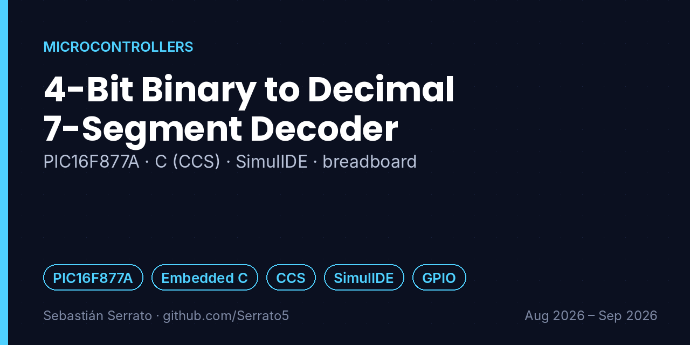
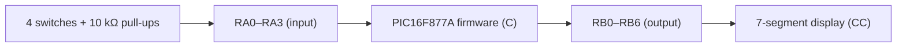

# 4-Bit Binary to Decimal 7-Segment Decoder

**PIC16F877A · C (CCS) · SimulIDE · breadboard**

`PIC16F877A` `Embedded C` `CCS` `SimulIDE` `GPIO`

## Overview

Design, simulation and physical implementation of a digital decoder that reads a 4-bit binary number from switches and shows its decimal value (0–9) on a common-cathode 7-segment display, using a PIC16F877A microcontroller.

## Key features

- **Hardware design:** Port A (RA0–RA3) reads the 4-bit input from mechanical switches with 10 kΩ pull-up resistors; Port B (RB0–RB6) drives a common-cathode 7-segment display.
- **Firmware:** Control logic written in C with the PIC C Compiler (CCS) to interpret the binary input and output the matching decimal digit (0 to 9).
- **Validation:** Circuit logic tested first in SimulIDE, then assembled on a breadboard, checking voltage levels and component stability.

## How it works

## What I learned

- Configuring PIC I/O ports and using pull-up resistors correctly.
- Mapping binary inputs to 7-segment patterns.
- Simulating before building saves time and components.

## Project context

| | |
|---|---|
| Context | Universidad Surcolombiana |
| Dates | Aug 2026 – Sep 2026 |
| Area | Microcontrollers |

## Resumen en español

Decodificador de binario de 4 bits a decimal en un display de 7 segmentos con un PIC16F877A programado en C (CCS): entradas por interruptores con pull-up de 10 kΩ en el puerto A, salida al display en el puerto B, simulado en SimulIDE y montado en protoboard.

---

**About this repository:** the original source code and design files of this project were not preserved. This repository documents what was built, how it works and what I learned, based on my project records. It does not contain reconstructed code.

**Sobre este repositorio:** el código y los archivos originales de este proyecto no se conservaron. Aquí se documenta qué se construyó, cómo funciona y qué aprendí, sin código reconstruido.

**Author:** Sebastián Serrato Ramírez · Electronic Engineering student, Universidad Surcolombiana (Neiva, Colombia) · [LinkedIn](https://www.linkedin.com/in/sebaserrato) · [More projects](https://github.com/Serrato5)
